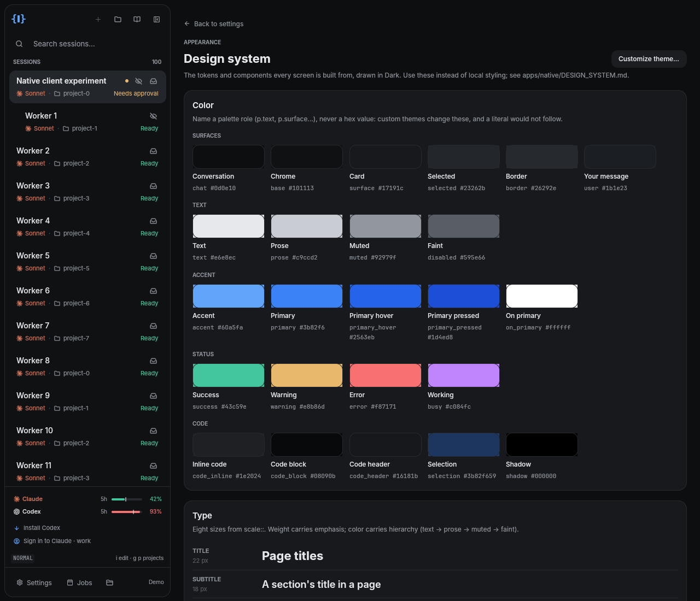
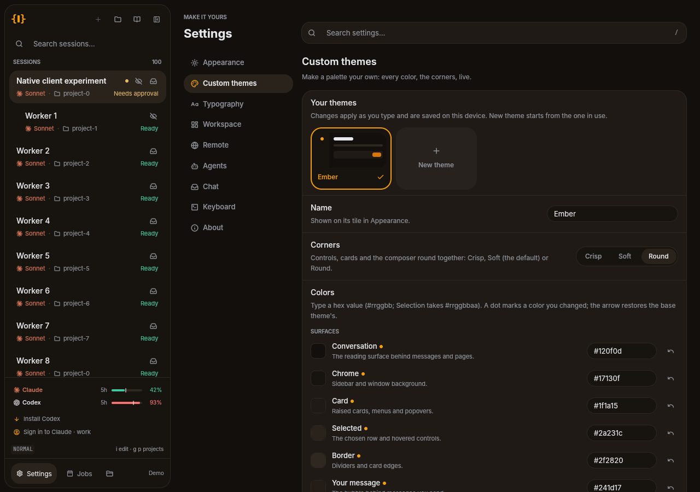
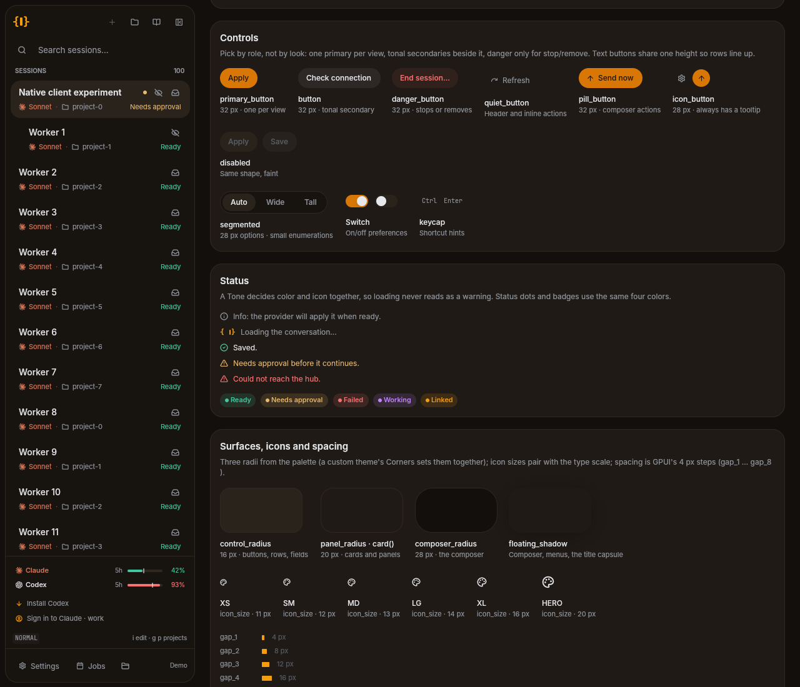

# Workspacer Native Design System

How the GPUI client looks and how to build UI that stays consistent with it. When you
add or touch a screen, use what is here; when you make a deliberate exception, write it
down in this file.

The live reference is in the app: **Settings → Appearance → Design system** (or `g y` in
Normal mode). It draws every token and component below with the real helpers, in the
active theme, so it is also the preview for a custom theme.



## The three layers

| Layer | Where | Changes with theme? |
|---|---|---|
| **Palette** — colors and the three surface radii | `src/appearance.rs` (`Palette`, built-ins, `CustomTheme`) | Yes: built-in or custom |
| **Tokens** — type, icon sizes, small radii, control heights, washes | `src/ui/tokens.rs` | No |
| **Components** — buttons, cards, notices, page frame | `src/ui/chrome.rs`, `Workspace::button*` in `src/ui.rs`, `segmented` in `src/ui/settings.rs` | Inherit both |

Rule of thumb: **name a role, never a value.** `rgb(p.muted)`, not `rgb(0x92979f)`;
`px(scale::META)`, not `px(12.)`; `self.button(..)`, not a hand-built div with a bg.

## 1. Color (palette roles)

Read the palette with `self.palette()` (never `self.appearance.palette()` — that skips
the active custom theme).

| Group | Roles | Use |
|---|---|---|
| Surfaces | `chat`, `base`, `surface`, `selected`, `border`, `user` | Conversation/page background, chrome (sidebar), raised cards, chosen row + hover, dividers, your message bubble |
| Text | `text`, `prose`, `muted`, `disabled` | Titles → body copy → descriptions → timestamps/unavailable. Hierarchy is color, not size |
| Accent | `accent`, `primary`, `primary_hover`, `primary_pressed`, `on_primary` | Links/focus/active choice; the one primary action and its states |
| Status | `success`, `warning`, `error`, `busy` | Done · needs you · failed/destructive · agent working |
| Code | `code_inline`, `code_block`, `code_header`, `selection`, `shadow` | Code surfaces, translucent selection (`0xRRGGBBAA`), floating shadow |

Tonal fills (a wash of `text` that works on any surface) go through
`chrome::tonal(p, alpha::…)`; status washes use the same `alpha::TONE*` steps over the
status color.

Exceptions (do not "fix"): `CLAUDE_CLAY` for the Claude mark (brand color); the Windows
caption close button's `0xc42b1c` hover (platform convention); syntax colors in
`syntax.rs` (per-theme tables).

## 2. Type (`scale::`)

| Token | px | Use |
|---|---|---|
| `TITLE` / `TITLE_SHORT` | 22 / 18 | Page title (`page_header` picks by window height) |
| `SUBTITLE` | 18 | A section's title inside a page (Settings category) |
| `HEADING` | 15 | Card and section headings |
| `LABEL` | 14 | Row titles: sessions, preferences, questions |
| `BODY` | 13 | Body copy, field values |
| `META` | 12 | Descriptions, notices, **button labels** |
| `CAPTION` | 11 | Chips, hints, dense metadata |
| `OVERLINE` | 10 | Uppercase overlines (`overline()`) |

Chat prose is the exception: it follows Settings → Typography → Conversation text size.

## 3. Icons (`icon_size::`)

Pair an icon with the text beside it: `XS` 11 (captions/chips) · `SM` 12 (quiet buttons,
metadata) · `MD` 13 (button icons, notice tones) · `LG` 14 (navigation rows, title
actions) · `XL` 16 (standalone header icons) · `HERO` 20 (empty states). Brand marks use
`provider_mark` / `provider_glyph` / `brand_badge`.

## 4. Shape

Surfaces take their radius from the palette, so a custom theme's **Corners** setting
(Crisp 6/8/12 · Soft 12/16/24 · Round 16/20/28) reshapes everything together:

- `p.control_radius` — buttons, rows, fields
- `p.panel_radius` — `card()`, settings groups, tiles
- `p.composer_radius` — the composer
- `rounded_full()` — pills: composer actions, icon buttons, status badges, segmented groups

Small marks inside those use `radius::HAIRLINE` (1), `MARK` (3), `TAG` (4), `BADGE` (8),
and a segmented group that may wrap uses `radius::SEGMENTED_GROUP`.

## 5. Spacing

GPUI's helpers are the scale: `gap_1`/`p_1` = 4 px, `_2` = 8, `_3` = 12, `_4` = 16,
`_5` = 20, `_6` = 24, `_8` = 32. Cards pad `p_4`; stacked cards and page sections gap
`gap_4`–`gap_5`; a label above its control gaps `gap_1`/`gap_2`.

## 6. Components

| Need | Use | Notes |
|---|---|---|
| The view's main action | `primary_button` | One per view. 32 px (`control::HEIGHT`) |
| Other actions | `button` | Tonal secondary, same height; long hub labels wrap |
| Stop/remove | `danger_button` | Error wash; never the primary |
| Header/inline action with icon | `quiet_button` | No fill at rest |
| Composer action | `pill_button` | 32 px pill, primary or tonal |
| Icon-only | `icon_button` / `primary_icon_button` | 28 px (`control::HEIGHT_SM`), always a tooltip |
| Small enumeration | `segmented` / `segmented_enabled` | 28 px options |
| On/off preference | `Switch` (gpui-component) | |
| Raised group | `chrome::card(p)` | |
| Status line | `chrome::notice_line(text, Tone, p)` | `Tone` picks color *and* icon; `notice_tone` classifies hub text |
| Page | `page_view` + `page_header` | Back action, overline, title, description, trailing actions |
| Settings row | `Entry` in `settings.rs` | `Layout::Row` or `Layout::Block` |
| Shortcut hint | `keycap` | |

All interactive controls go through `chrome::interactive_control`, which reserves the
2 px focus ring (keyboard-only) so focus never shifts layout.

### Sidebar controls

The sidebar keeps few controls in view, and the collapsed rail keeps the same ones in
the same order:

| Place | Holds | Controls |
|---|---|---|
| Header | Window chrome only | Collapse |
| Search row | The sidebar's one action, tonal so it stands apart | New agent |
| Status line | Shown only when there is something to say | Connection label · Update |
| Footer | The Workspace menu and Settings | Workspace · Settings |

Every destination (All projects, Session history, Jobs, Hosts) is a labelled
row in the **Workspace** menu, not an icon of its own: places visited now and then read
better as words than as a row of icons to memorise. A new destination is a new row in
`nav_destinations()`; a new status joins the status line. The menu button reads
as selected while one of its pages is open.

## 7. Custom themes

**Settings → Custom themes** forks the theme in use into an editable copy:



- Every palette role above is editable as hex (`#rrggbb`; Selection takes `#rrggbbaa`);
  changes apply as you type. Corners set all three radii at once.
- Only changed colors are stored (`native-custom-themes.json`, beside
  `native-theme.json`), so a role added to built-ins later still gets a value.
- **Readability** runs the same contrast floors the built-in themes are tested against
  (`appearance::contrast_checks`) and lists any pair that falls short.
- Syntax colors and the component library's light/dark mode follow the base theme, or
  Dark/Light if your edits flip the conversation surface's brightness.
- Picking a built-in deactivates the custom theme; deleting the active one returns to its base.

Adding a palette role is a three-place change: the `Palette` field and every built-in
in `appearance.rs`, `TOKENS` (so the editor and gallery list it), and `Palette::get`/`slot`.

## 8. Keeping it consistent

- `tokens::tests::tokens_are_used_instead_of_literals` fails when `src/ui` (outside
  `tokens.rs` and tests) writes a numeric font size, icon size, corner radius or
  `tonal(p, <number>)`. Add a token (and a row here) instead of a literal.
- Built-in palettes are held to contrast floors in `appearance.rs` tests; custom themes
  show the same checks live.
- Capture a screen in any theme (including a custom one) with `scripts/smoke.py`:

```sh
python3 scripts/smoke.py --binary target/debug/wks-native --screen design --no-input --output design.png
python3 scripts/smoke.py --binary target/debug/wks-native --screen design --no-input --wheel 20 \
  --custom-themes my-themes.json --output design-controls.png
```


